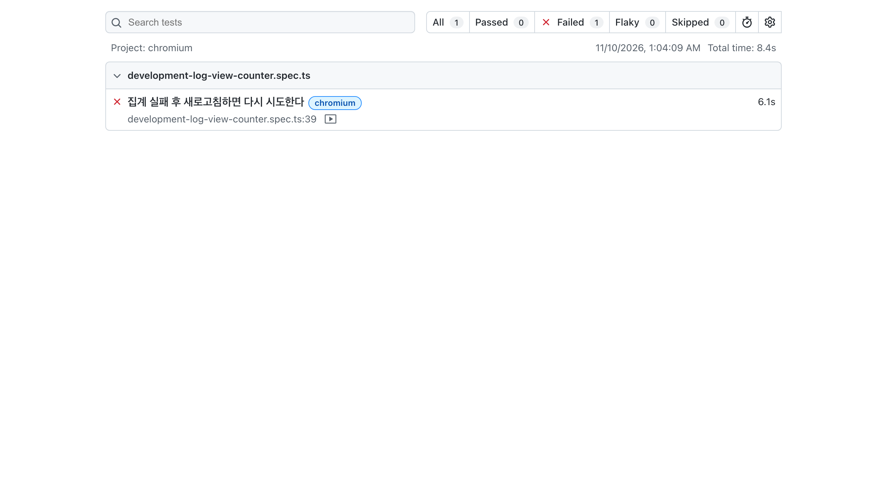
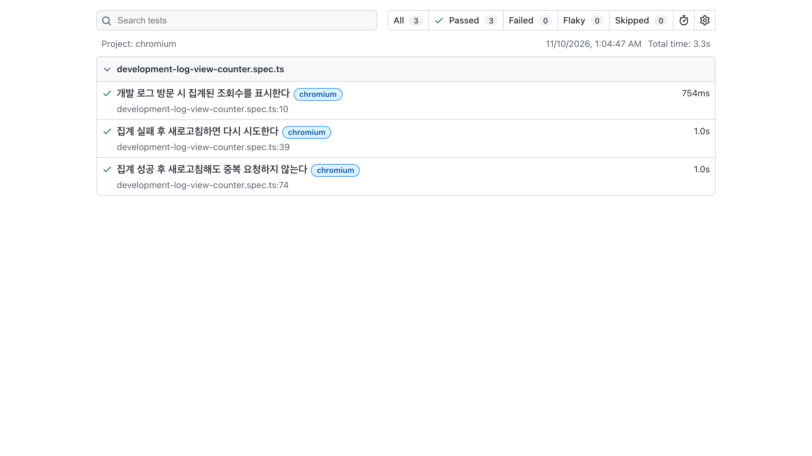

# Playwright로 조회수 집계 회귀를 검증한 기록

- 검증일: 2026-11-10
- 대상: 개발 로그 조회수 집계
- 도구: Playwright 1.65.0, Chromium
- 범위: React hydration, browser fetch, localStorage, 새로고침과 화면 갱신

## 왜 이 흐름을 골랐나

AI가 작성하거나 수정한 코드는 정상 경로만 보면 그럴듯하게 동작해도 실패와 재실행
경계에서 결함이 남을 수 있다. 개발 로그 조회수 집계는 페이지 진입 뒤 자동으로 API를
호출하고, 30분 중복 방지를 위해 localStorage를 사용한다. 정상 응답뿐 아니라 API 실패와
새로고침을 함께 통과해야 의도한 동작을 보장할 수 있는 흐름이다.

검증할 사용자 계약을 다음과 같이 정했다.

1. 개발 로그에 들어오면 집계된 오늘·누적 조회수를 표시한다.
2. 집계 API가 실패해도 글은 계속 표시하며, 새로고침하면 집계를 다시 시도한다.
3. 집계에 성공했다면 새로고침해도 30분 동안 중복 요청하지 않는다.

## 테스트 경계

[브라우저 테스트](../../e2e/development-log-view-counter.spec.ts)는 실제 Next.js 페이지와
[조회수 Client Component](../../features/development-log/components/DevelopmentLogViewCounter.tsx)를
Chromium에서 실행한다. `/api/log-views` 응답은 `page.route()`로 통제해 운영 DB를 변경하지
않고 정상 응답과 503 실패를 재현했다.

따라서 이 테스트가 실제로 통과하는 경계는 다음과 같다.

```text
Next.js 페이지 → React hydration → useEffect → browser fetch
→ 응답 파싱 → localStorage → 화면 갱신 → 새로고침
```

앱의 Route Handler와 PostgreSQL 저장은 통과하지 않는다. 엄밀하게는 DB까지 검증하는
완전한 E2E가 아니라 Playwright 브라우저 회귀 테스트다. API 요청 검증과 서버 중복 집계
계약은 기존 단위·route 테스트가 담당한다.

테스트 전용 페이지는 `PLAYWRIGHT_TEST=1`일 때만 열리며, 일반 개발·운영 환경에서는 404를
반환한다. Playwright 설정은 [playwright.config.ts](../../playwright.config.ts)에 두었다.

## 수정 전 테스트가 잡은 문제

첫 실행 결과는 정상·중복 방지 2개 통과, 실패 후 재시도 1개 실패였다.



_수정 전 재현: `집계 실패 후 새로고침하면 다시 시도한다` 시나리오가 Chromium에서 실패했다._

```text
2 passed, 1 failed

Expected substring: "누적 43"
Received string:    "2026. 11. 10.·오늘 6·누적 41"
```

기존 구현은 API 요청을 보내기 전에 localStorage에 집계 시각을 기록했다. 요청이 503으로
실패해도 기록이 남아 새로고침 시 `이미 집계됨`으로 판단했고, 30분 동안 재시도하지 않았다.

```text
첫 요청 시작 → localStorage 기록 → API 503
→ 실패 기록 유지 → 새로고침 → 요청 생략
```

## 수정

동시 실행은 계속 막되, 실패한 요청이 자신이 남긴 집계 시각과 현재 저장값이 같을 때만 해당
값을 제거하도록 수정했다. 다른 탭이나 이후 요청이 남긴 더 새로운 값을 무조건 삭제하지
않도록 현재 값도 함께 비교했다.

```text
첫 요청 시작 → localStorage 기록 → API 503
→ 해당 요청의 기록 제거 → 새로고침 → 재요청 성공
```

## 수정 후 결과



_수정 후 검증: 정상·실패 후 재시도·중복 방지 시나리오가 모두 통과했다._

```text
3 passed

✓ 개발 로그 방문 시 집계된 조회수를 표시한다
✓ 집계 실패 후 새로고침하면 다시 시도한다
✓ 집계 성공 후 새로고침해도 중복 요청하지 않는다
```

저장소 전체 검증은 다음 명령으로 수행한다.

```bash
npm run test:e2e
npm run check
npm run build
```

## 남은 범위

- 현재 browser 회귀 테스트는 Chromium 한 종류만 실행한다.
- 실제 Route Handler와 DB까지 통과하는 E2E는 격리된 test DB와 데이터 초기화가 필요하다.
- localStorage를 공유하는 여러 탭의 동시 경쟁은 별도 multi-page 시나리오로 확장할 수 있다.

이번 검증에서 중요한 결과는 테스트 개수가 아니라, 정상 경로만으로는 보이지 않던 실패 후
복구 결함을 재현하고 수정 전 실패와 수정 후 통과를 같은 테스트로 확인했다는 점이다.
